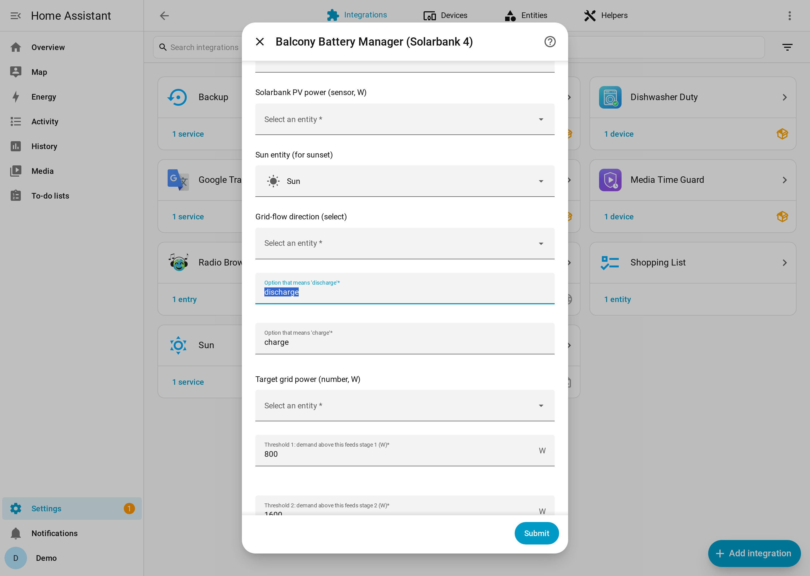
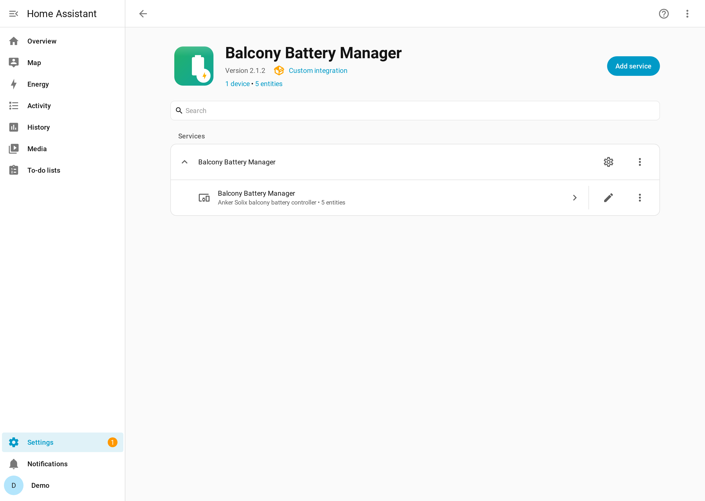
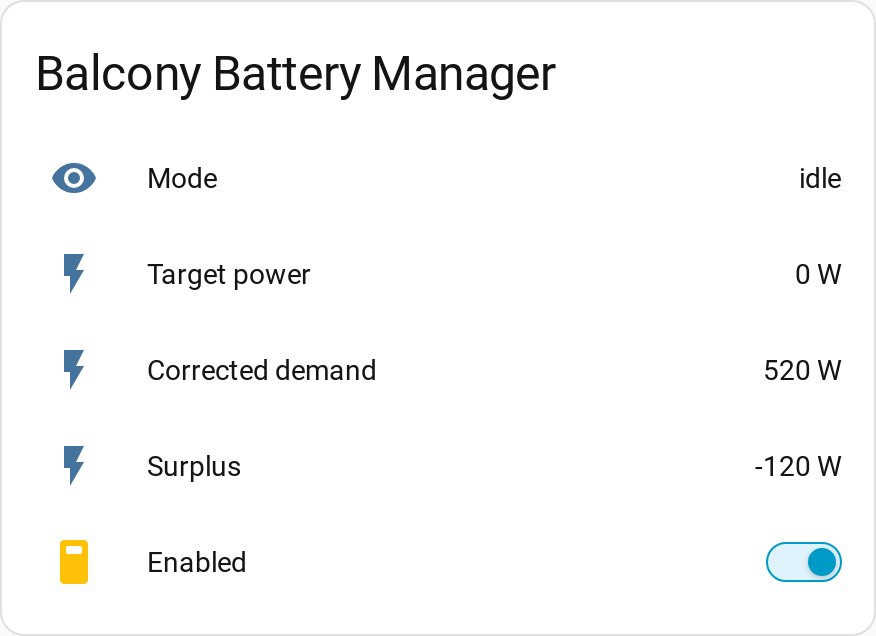
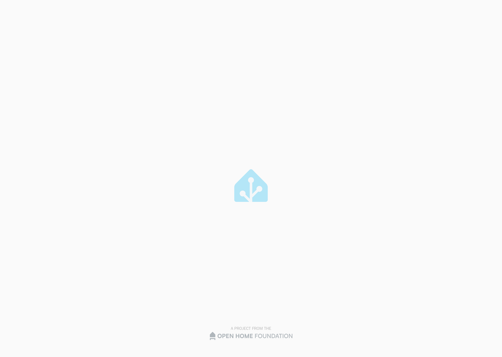

# Balcony Battery Manager

**Local Home Assistant controller for an Anker SOLIX Solarbank 4 (E5000 Pro):** it feeds in when your house draws a lot from the main battery, charges from PV surplus when PV alone will not fill the Solarbank by sunset, and covers the house when the main battery is empty.

[](https://hacs.xyz)
[](https://github.com/Jo-Highness/balcony_battery_manager/actions/workflows/validate.yml)
[](https://github.com/Jo-Highness/balcony_battery_manager/actions/workflows/test.yml)
[](https://github.com/Jo-Highness/balcony_battery_manager/releases)
[](LICENSE)
[](https://www.home-assistant.io)

🇩🇪 [Deutsche Version](README.de.md)

> **This integration drives real hardware.** Every control cycle it writes a
> power setpoint and a charge/discharge direction to your Solarbank. Read
> [Safety](#safety) before you switch it on.

## Quick start

1. **Prepare the Solarbank.** Install an Anker Solix integration that exposes the
   Solarbank 4 *Third-Party Control* entities (e.g. `anker_solix_official`) and
   switch the Solarbank to **Third-Party Control** there. You need two
   actuators: a grid-flow **select** (charge / discharge) and a target grid
   power **number** (W).
2. **Install** via HACS:
   [](https://my.home-assistant.io/redirect/hacs_repository/?owner=Jo-Highness&repository=balcony_battery_manager&category=integration)
   → install **Balcony Battery Manager** → restart Home Assistant.
3. **Add the integration** (Settings → Devices & services → Add integration →
   *Balcony Battery Manager*) and pick **5 sensors** (main-battery power, grid
   power, Solarbank output, Solarbank SoC, Solarbank PV power) and the **2
   actuators**. Unambiguous Solarbank entities are pre-filled.
4. **Check the signs** in *Developer tools → States* while the house draws from
   the main battery: *Corrected demand* must be **positive**; while exporting,
   *Surplus* must be **positive**. If not, flip the matching
   *Positive = …* switch in the options.
5. **Watch it work:** the **Mode** sensor shows `idle`, `discharge`, `charge`,
   `grid_support`, `failsafe` or `disabled`, its `reason` attribute says why.
   Add the [dashboard card](#dashboard) below.

---

## Contents

- [Safety](#safety)
- [How it works](#how-it-works)
- [Configuration](#configuration)
- [Entities](#entities)
- [Actions](#actions)
- [Dashboard](#dashboard)
- [Automation examples](#automation-examples)
- [Troubleshooting / FAQ](#troubleshooting--faq)
- [Upgrade notes](#upgrade-notes)
- [Requirements document](docs/requirements.md) · [Changelog](CHANGELOG.md)

## Safety

- **Returning control to the Anker app.** Turn the **Enabled** switch off (or
  call `balcony_battery_manager.disable`). The controller sets the target power
  to **0 W**. The grid-flow select and the Solarbank's operating mode are *not*
  changed unless you configure the optional **operating-mode select** with a
  **mode when disabled** (e.g. the Anker app's own mode) — then that mode is
  restored automatically. Without it, switch the Solarbank back to its normal
  mode in the Anker app / Anker integration yourself.
- **Removing / reloading** the integration also leaves the Solarbank at 0 W.
- **Minimum SoC.** No discharge mode (staircase or grid support) runs at or
  below *Minimum Solarbank SoC* (default 10 %). The Solarbank's own limits still
  apply on top.
- **No grid charging.** Charging is a closed loop on the *measured export*: it
  only absorbs export above the *export reserve* and never pulls from the grid
  or the main battery on purpose. Short overshoots after a sudden load change
  are corrected in the next cycle.
- **800 W feed-in.** On the Solarbank 4, the third-party target grid power for
  discharging tops out at about **800 W** (a device/firmware limit and the usual
  limit for plug-in solar in Germany). All setpoints are clamped to the number
  entity's own min/max anyway.
- **Fail-safe.** If a required sensor is unavailable or reports an unsupported
  unit, or an actuator write fails or times out, the controller writes **0 W**.
- **Direction changes** always go *power 0 W → switch direction → new setpoint*.
- **One controller per Solarbank.** A second entry for the same actuators is
  rejected.

## How it works

Each cycle (default every 30 s) the controller reads the sensors, decides
**exactly one** mode, and writes the setpoint:

| Mode | When | Setpoint |
|---|---|---|
| `grid_support` | Main-battery SoC at/below *empty* (optional sensor set) and Solarbank above its minimum SoC | Covers main-battery draw + grid import except a small *residual grid import*, up to *maximum grid-support feed-in* |
| `discharge` | *Corrected demand* stays above threshold 1 / 2 for the full *dwell time* | Stage 1 / stage 2 feed-in |
| `charge` | Remaining PV until sunset is not enough to reach the *target SoC* and there is export | Closed loop: export above the *reserve* |
| `idle` | Nothing to do | 0 W |
| `failsafe` | A required sensor is missing/invalid | 0 W |
| `disabled` | Master switch off | 0 W |

**Corrected demand** = main-battery draw + current Solarbank output. The meter
of the main battery only sees what the Solarbank does *not* cover; adding the
Solarbank output back gives the real demand, independent of our own setpoint.

**Remaining PV** is estimated from the live Solarbank PV power, capped at the PV
nominal power and, from the *afternoon boundary* on, at nominal × *afternoon
factor*, integrated until the next sunset. Sunset comes from `sun.sun`; without
it, it is calculated from the Home Assistant location (last resort: 21:00 local).

## Configuration

Everything is configured in the UI and can be changed later via **Configure**
(the entry reloads). The form is split into sections; each field has a help
text. Numbers marked *example* are defaults from a multi-battery setup — adjust
them to yours.

**Measurements** — power sensors may report W, kW or MW; SoC must be in %.

| Field | Required | Notes |
|---|---|---|
| Main-battery power | yes | Sign switch *Positive = discharge into house* (turn off for e.g. E3DC, which reports discharge as negative). |
| Grid power | yes | Sign switch *Positive = export to grid*. |
| Solarbank output to house | yes | AC output of the Solarbank. |
| Solarbank state of charge | yes | % |
| Solarbank PV power | yes | |
| Sun entity | no | Default `sun.sun`. |

**Solarbank actuators**

| Field | Required | Notes |
|---|---|---|
| Grid-flow direction (select) | yes | |
| Option for "discharge" / "charge" | yes | Exact option values of that select (validated). |
| Target grid power (number) | yes | W or kW; values are clamped to its min/max. |
| Operating-mode select | no | Only needed to switch modes automatically. |
| Mode while controlling | no | Selected before power is commanded (e.g. third-party control). |
| Mode when disabled | no | Restored when the controller is disabled. |

**Discharge staircase**: threshold 1 / 2 (800 / 1600 W, threshold 1 must be
lower), stage 1 / 2 feed-in (350 / 800 W), dwell time (10 min), hysteresis
(100 W), minimum Solarbank SoC (10 %).

**Predictive PV charging**: maximum charge power (2500 W, *example*; also capped
at the number's max), export reserve (100 W), target SoC (100 %), usable
capacity (15.5 kWh, *example* — enter your Solarbank incl. expansion
batteries), PV nominal power (2000 W), afternoon boundary (13 h), afternoon
factor (0.33).

**Grid support**: on/off (on), main-battery SoC sensor (optional — empty
disables grid support), empty at (10 %), release hysteresis (3 %), residual grid
import (100 W), maximum feed-in (800 W).

**General**: control interval (30 s, 5–600 s), deadband (25 W — smaller setpoint
changes are not written).

## Entities

One service device **Balcony Battery Manager** with:

| Entity | Example entity id | Details |
|---|---|---|
| Mode | `sensor.balcony_battery_manager_mode` | Enum: `idle`, `discharge`, `charge`, `grid_support`, `failsafe`, `disabled`. Attributes: `grid_flow`, `applied_power`, `charge_release`, `need_wh`, `rest_pv_wh`, `reason` (German text). |
| Target power | `sensor.balcony_battery_manager_target_power` | Decided setpoint in W. |
| Corrected demand | `sensor.balcony_battery_manager_corrected_demand` | W |
| Surplus | `sensor.balcony_battery_manager_surplus` | Live export in W (negative = grid import; 0 in fail-safe). |
| Enabled | `switch.balcony_battery_manager_enabled` | Master switch; the state survives restarts. |

Diagnostics can be downloaded from the integration page.

## Actions

| Action | Description |
|---|---|
| `balcony_battery_manager.enable` | Enable control and run a cycle immediately. |
| `balcony_battery_manager.disable` | Disable control: 0 W and, if configured, restore the Anker operating mode. |
| `balcony_battery_manager.recalculate_now` | Run a cycle now. |

All accept an optional `config_entry_id`; without it they act on every entry.

## Dashboard

```yaml
type: entities
title: Balcony battery
entities:
  - entity: switch.balcony_battery_manager_enabled
  - entity: sensor.balcony_battery_manager_mode
  - type: attribute
    entity: sensor.balcony_battery_manager_mode
    attribute: reason
    name: Reason
  - entity: sensor.balcony_battery_manager_target_power
  - entity: sensor.balcony_battery_manager_corrected_demand
  - entity: sensor.balcony_battery_manager_surplus
```

## Automation examples

Notify when the controller enters fail-safe:

```yaml
alias: Balcony battery – notify on fail-safe
triggers:
  - trigger: state
    entity_id: sensor.balcony_battery_manager_mode
    to: "failsafe"
    for: "00:02:00"
actions:
  - action: persistent_notification.create
    data:
      title: Balcony Battery Manager
      message: >-
        Fail-safe: {{ state_attr('sensor.balcony_battery_manager_mode', 'reason') }}.
        The Solarbank was set to 0 W.
mode: single
```

Hand control to the Anker app while a helper is on (e.g. during maintenance)
and take it back afterwards:

```yaml
alias: Balcony battery – manual mode
triggers:
  - trigger: state
    entity_id: input_boolean.solarbank_manual
actions:
  - if:
      - condition: state
        entity_id: input_boolean.solarbank_manual
        state: "on"
    then:
      - action: balcony_battery_manager.disable
    else:
      - action: balcony_battery_manager.enable
mode: queued
```

> Do not switch the controller off "at night": grid support (main battery
> empty) is most useful exactly then.

## Troubleshooting / FAQ

**The Solarbank never feeds in under high load.** Check the sign switches (see
Quick start step 4) and that the Solarbank is above the minimum SoC.

**Mode stays `failsafe`.** One of the five required sensors is unavailable or
uses an unsupported unit; the log names it.

**Grid support never starts.** It needs the optional main-battery SoC sensor,
*Grid support* on, the main-battery SoC at/below *empty at* and the Solarbank
above its minimum SoC.

**Setpoints are ignored.** The Solarbank must be in *Third-Party Control*
(configure the optional operating-mode select to enforce it).

**Debug logging**

```yaml
logger:
  logs:
    custom_components.balcony_battery_manager: debug
```

## Upgrade notes

- **2.2.0** requires Home Assistant **2025.2** or newer. Existing entries are
  migrated automatically (settings move into the entry options). The *Enabled*
  switch is no longer a configuration entity. Power sensors in kW are now read
  correctly — if you compensated for the old behaviour, undo that.
- **2.0.0** was a rewrite for the Solarbank **4**; Solarbank 3 (v1) entries
  cannot be migrated — remove and re-add the integration.

## Screenshots

> Captured from a demo Home Assistant with fictional data (version 2.1).

| Setup | Entities | Dashboard | Integrations |
|---|---|---|---|
|  |  |  |  |

## Contributing · License · Credits

Issues and pull requests are welcome — see [CONTRIBUTING.md](CONTRIBUTING.md).
Released under the [MIT License](LICENSE). Thanks to the Anker Solix community
integration effort for the third-party-control entities, and to the
[Home Assistant](https://www.home-assistant.io) project.
